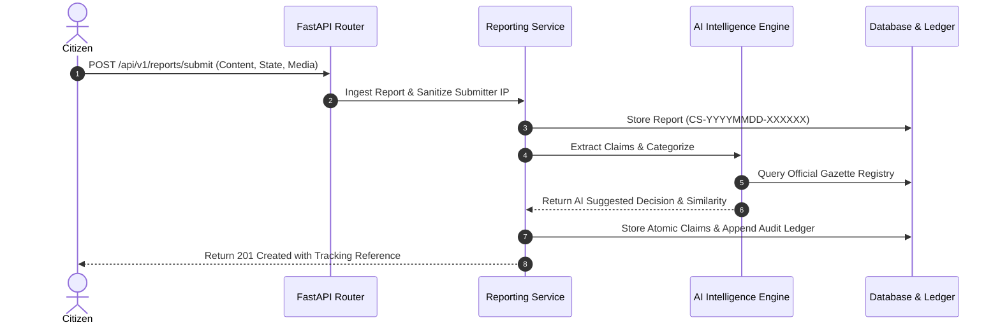
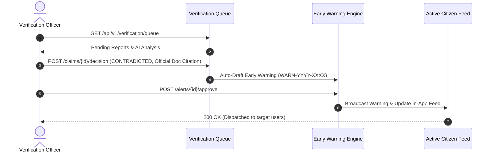

# CIVICSHIELD NG — SYSTEM ARCHITECTURE SPECIFICATION

**Project Identity:** CivicShield NG  
**Mission:** *"Detect early. Verify intelligently. Protect securely. Respond collectively."*  
**Architecture Pattern:** Modular Monolith with Shared Kernel, Clean Architecture Layers, and Dual-Portal UI.

---

## 1. System Overview

CivicShield NG is an AI-powered Electoral Information Integrity and Threat Intelligence Platform engineered specifically for Nigeria's electoral ecosystem. It addresses the challenges of AI-generated misinformation, coordinated information manipulation campaigns, forged electoral notices, and threats to electoral systems.

The platform exposes two synchronized interfaces powered by unified backend services:
1. **CivicShield AI (Citizen Portal):** Low-friction reporting interface, report tracking (`CS-YYYYMMDD-XXXXXX`), cryptographic announcement verification, and conversational AI assistant.
2. **CivicShield Command Centre (Institutional Dashboard):** Mission control room for Verification Officers, Intelligence Analysts, and Security Administrators to triage queues, detect coordinated amplification, broadcast early warnings, and verify tamper-evident audit ledgers.

```
+-----------------------------------------------------------------------------------+
|                                 USER EXPERIENCES                                  |
|   +---------------------------------------+  +--------------------------------+   |
|   |     CivicShield AI (Citizen)         |  | CivicShield Command Centre     |   |
|   |  - Report Ingestion & Media Upload    |  |  - Threat KPIs & Velocity Map  |   |
|   |  - Public Report Tracker              |  |  - Verification Review Queue   |   |
|   |  - Certified Gazette Registry Search  |  |  - Coordinated Narrative Graph |   |
|   |  - Conversational AI Assistant        |  |  - Dual-Key Warning Broadcast  |   |
|   |  - Active Early Warning Feed          |  |  - Tamper-Evident Ledger Audit |   |
|   +---------------------------------------+  +--------------------------------+   |
+------------------------------------------+----------------------------------------+
                                           | HTTPS / JSON (REST API)
+------------------------------------------v----------------------------------------+
|                            FASTAPI BACKEND CORE                                   |
|   +---------------------------------------------------------------------------+   |
|   | API Router Layer: /api/v1 (Prefix-routed, Pydantic V2 validated)          |   |
|   +---------------------------------------------------------------------------+   |
|   | Security & Guard Layer: JWT Bearer, Argon2id, RBAC Guards, Prompt Defense |   |
|   +---------------------------------------------------------------------------+   |
|   | Domain Service Modules:                                                   |   |
|   |  1. Auth & RBAC Service (Brute-force Lockout, Token Lifecycle)            |   |
|   |  2. Reporting Service (CS-YYYYMMDD-XXXXXX, IP Salted Hashing, Uploads)    |   |
|   |  3. Registry Service (Canonical SHA-256 Hashing, Tamper Detection)        |   |
|   |  4. AI Intelligence Engine (Jaccard Similarity, Intent & Contradiction)  |   |
|   |  5. Verification Centre Service (Queue Triage, Authoritative Decisions)   |   |
|   |  6. Early Warning Engine (WARN-YYYY-XXXX, Dual-Key Approval, Geo Targets)  |   |
|   |  7. Narrative Intelligence (Jaccard Clustering, Velocity Scores, Graph)   |   |
|   |  8. Security & Audit Service (SHA-256 Chained Ledger, Threat Incidents)   |   |
|   +---------------------------------------------------------------------------+   |
+------------------------------------------+----------------------------------------+
                                           | SQLAlchemy 2.x (Parameterized ORM)
+------------------------------------------v----------------------------------------+
|                           PERSISTENCE & STORAGE                                   |
|  - Relational Database: SQLite with WAL & Foreign Keys (Dev) / PostgreSQL (Prod)  |
|  - Storage Engine: Protected Media Vault with SHA-256 Fingerprinting              |
|  - Cryptographic Chain: Immutable Audit Ledger with Genesis Chaining              |
+-----------------------------------------------------------------------------------+
```

---

## 2. Core Functional Modules

### 2.1. Authentication and Access Control (RBAC)
- **Password Security:** Argon2id with memory cost 65,536 KB, time cost 3, parallelism 4.
- **Token Lifecycle:** HMAC-SHA256 JWT access tokens (60 min expiry) and refresh tokens (7 days).
- **Brute-Force Lockout:** Tracks consecutive failed authentication attempts per email. Exceeding 5 failures locks the account for 15 minutes.
- **Role Hierarchy:**
  - `CITIZEN`: Submit reports, view own reports, view public registry.
  - `ANALYST`: Analyze claims, view all reports, view narrative clusters.
  - `VERIFICATION_OFFICER`: Authoritative claim decisions, draft early warnings, withdraw alerts.
  - `SECURITY_OFFICER`: View audit ledger, verify cryptographic hash chain, resolve security events.
  - `ADMINISTRATOR`: Superuser role granting all system permissions and institutional user management.

### 2.2. AI Misinformation Intelligence Engine
- **Prompt Injection Defense:** Multi-layer sanitization filtering 15+ adversarial jailbreak markers (`ignore all previous instructions`, `<script>`, markdown image exfiltration, SQL injection tokens).
- **Atomic Claim Extraction:** Extracts factual assertions from submitted reports.
- **Electoral Lexicon Classification:** Assigns electoral domain categories (`RESULTS_ANNOUNCEMENT`, `ELECTION_SCHEDULE`, `INEC_OPERATIONS`, `SECURITY_INCIDENT`, `VOTER_REGISTRATION`, `POLITICAL_PARTIES`, `POLLING_LOGISTICS`).
- **Official Gazette Comparison:** Computes stop-word filtered Jaccard similarity between claims and certified official records in the gazette registry. Flags candidate contradictions with confidence scores without making final autonomous rulings.
- **Verification States:** `UNVERIFIED`, `UNDER_REVIEW`, `VERIFIED`, `CONTRADICTED`, `INSUFFICIENT_EVIDENCE`, `WITHDRAWN`.

### 2.3. Official Information Verification Registry
- **Certified Repository:** Stores announcements, press releases, and gazettes published by INEC and State Independent Electoral Commissions (SIECs).
- **Canonical Hash Computation:** Standardizes content (case normalization, whitespace trimming) and calculates SHA-256 cryptographic fingerprints.
- **Document Integrity Verification:** Extracts document codes from circulating claims and compares computed text hashes against registered originals, distinguishing authentic matches, unauthenticated claims, and suspected tampering.

### 2.4. Coordinated Narrative Detection
- **Narrative Clustering:** Groups recurring reports sharing core factual assertions across Nigerian states.
- **Propagation Velocity Score:** Calculates velocity index based on report volume, geographic spread, and time interval:
  $$\text{Velocity} = \frac{\text{Report Count} \times \text{Unique States}}{\Delta \text{Hours} + 1}$$
- **Threat Indicator Matrix:** Flags high-risk signals including duplicate text reuse, multi-state amplification, and unverified viral assertions.

### 2.5. Early Warning and Notification Engine
- **Broadcast Workflow:** Dual-key approval model:
  1. Verification Officer / Analyst drafts warning with code `WARN-YYYY-XXXX`.
  2. Authorized Officer reviews and signs off on publication.
  3. Dispatch across in-app channels and active public feed.
- **Suppression Windows:** 4-hour duplicate alert suppression prevents alert fatigue across identical incident categories.
- **Geographic Targeting:** Targeted delivery (National or state-specific, e.g., Kano, Rivers, Lagos) honoring user notification preferences.

### 2.6. Database Security and Tamper-Evident Audit Ledger
- **Cryptographic Hash Chaining:** Every consequential event (`USER_REGISTER`, `REPORT_SUBMITTED`, `DOCUMENT_CERTIFIED`, `CLAIM_VERIFIED`, `ALERT_PUBLISHED`) computes:
  $$\text{Hash}_n = \text{SHA256}(\text{Hash}_{n-1} \,\|\, \text{Action} \,\|\, \text{Entity ID} \,\|\, \text{Timestamp})$$
- **Dynamic Ledger Verification:** Recursively traverses all ledger links. Proves whether any historical database record has been altered, tampered with, or deleted.
- **Security Incident Resolution:** Security Officers investigate automated alerts (tampering, brute-force attacks) and resolve incidents with encrypted notes.

---

## 3. Data Flow Pipelines

### 3.1. Citizen Report Ingestion & Automated Triage


### 3.2. Authoritative Human Verification & Early Warning Broadcast


---

## 4. Architectural Invariants

1. **AI Never Declares Final Rulings:** Machine learning and heuristic pipelines only generate decision support signals, triage scores, and similarity matches. Only accredited human officers can mark a claim `CONTRADICTED` or `VERIFIED`.
2. **Zero Plaintext Submitter IP Storage:** Citizen IP addresses are never persisted in plaintext. Only salted SHA-256 cryptographic hashes are recorded for rate limiting and abuse defense.
3. **No Unsafe Raw SQL String Interpolation:** All queries utilize parameterized SQLAlchemy 2.x expressions with strict Pydantic V2 body validation.
4. **Tamper-Evident Continuity:** No audit record may be inserted without cryptographically referencing the immediately preceding ledger hash.
