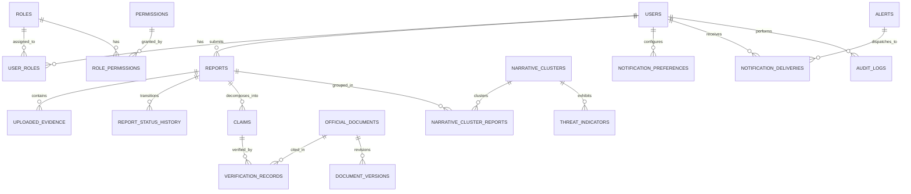

# CIVICSHIELD NG — DATABASE SCHEMA SPECIFICATION

**Database Engine:** SQLite 3 with Write-Ahead Logging (WAL) and Foreign Key Pragmas (Development / Local); PostgreSQL 16+ (Production).  
**ORM Framework:** SQLAlchemy 2.0 (Fully Type-Annotated with `Mapped` and `mapped_column`).  
**Schema Migration Engine:** Alembic.

---

## 1. Entity-Relationship Overview

---

## 2. Table Data Dictionary

### 2.1. Authentication & RBAC

#### `users`
| Column | Type | Constraints | Description |
|---|---|---|---|
| `id` | VARCHAR(36) | PRIMARY KEY | Unique UUID identifier |
| `email` | VARCHAR(255) | UNIQUE, NOT NULL, INDEX | Citizen or officer email |
| `hashed_password` | VARCHAR(255) | NOT NULL | Argon2id password hash |
| `full_name` | VARCHAR(255) | NOT NULL | User's full legal or preferred name |
| `phone_number` | VARCHAR(20) | NULLABLE | Nigerian phone number (+234 format) |
| `state_of_residence` | VARCHAR(100) | NULLABLE, INDEX | Nigerian state or FCT |
| `is_active` | BOOLEAN | NOT NULL, DEFAULT true | Account active state |
| `is_verified` | BOOLEAN | NOT NULL, DEFAULT false | Institutional verification flag |
| `failed_login_attempts` | INTEGER | NOT NULL, DEFAULT 0 | Counter for brute-force lockout |
| `locked_until` | DATETIME | NULLABLE | Lockout expiry timestamp |
| `created_at` / `updated_at` | DATETIME | NOT NULL | ISO UTC timestamps |

#### `roles` & `permissions`
- `roles`: Defines named platform roles (`CITIZEN`, `ANALYST`, `VERIFICATION_OFFICER`, `SECURITY_OFFICER`, `ADMINISTRATOR`).
- `permissions`: Atomic capabilities (`reports:create`, `claims:verify`, `alerts:approve`, `audit:read`, etc.).
- Association tables: `user_roles` and `role_permissions` enforce many-to-many RBAC mappings.

---

### 2.2. Reporting & Verification

#### `reports`
| Column | Type | Constraints | Description |
|---|---|---|---|
| `id` | VARCHAR(36) | PRIMARY KEY | UUID identifier |
| `reference_number` | VARCHAR(24) | UNIQUE, NOT NULL, INDEX | Human tracking code: `CS-YYYYMMDD-XXXXXX` |
| `reporter_id` | VARCHAR(36) | FK -> users.id (ON DELETE SET NULL) | Optional registered reporter |
| `is_anonymously_submitted` | BOOLEAN | NOT NULL, DEFAULT true | Privacy flag |
| `submitter_ip_hash` | VARCHAR(64) | NULLABLE, INDEX | Salted SHA-256 IP hash (never plaintext) |
| `content_text` | TEXT | NOT NULL | Claim description or transcript |
| `source_platform` | VARCHAR(50) | NOT NULL, INDEX | Platform (WhatsApp, X, Facebook, etc.) |
| `source_url` | VARCHAR(1000) | NULLABLE | Circulating web URL |
| `nigerian_state` | VARCHAR(100) | NULLABLE, INDEX | Relevant Nigerian state |
| `status` | VARCHAR(32) | NOT NULL, DEFAULT 'PENDING' | Workflow status |
| `priority` | VARCHAR(16) | NOT NULL, DEFAULT 'MEDIUM' | Triage priority |
| `ai_triage_score` | FLOAT | NOT NULL, DEFAULT 0.0 | Calculated automated risk score |

#### `claims`
| Column | Type | Constraints | Description |
|---|---|---|---|
| `id` | VARCHAR(36) | PRIMARY KEY | UUID identifier |
| `report_id` | VARCHAR(36) | FK -> reports.id (CASCADE) | Originating report |
| `extracted_claim` | TEXT | NOT NULL | Atomic extracted factual assertion |
| `category` | VARCHAR(64) | NOT NULL, INDEX | Electoral domain category |
| `ai_confidence_score` | FLOAT | NOT NULL | Model confidence [0.0 - 1.0] |
| `ai_suggested_status` | VARCHAR(32) | NOT NULL | AI recommendation (`CONTRADICTED`, `VERIFIED`, etc.) |
| `requires_human_review`| BOOLEAN | NOT NULL, DEFAULT true | Safety invariant flag |
| `verification_decision`| VARCHAR(32) | NULLABLE, INDEX | Authoritative human decision |

---

### 2.3. Certified Registry & Early Warnings

#### `official_documents`
| Column | Type | Constraints | Description |
|---|---|---|---|
| `id` | VARCHAR(36) | PRIMARY KEY | UUID identifier |
| `document_code` | VARCHAR(64) | UNIQUE, NOT NULL, INDEX | Normalized identifier (e.g. `INEC-2026-PRESS-04`) |
| `issuing_institution` | VARCHAR(255) | NOT NULL, INDEX | INEC, SIEC, Police, Judiciary |
| `title` | VARCHAR(500) | NOT NULL | Official document title |
| `content` | TEXT | NOT NULL | Full certified gazette content |
| `summary` | TEXT | NOT NULL | Executive summary |
| `sha256_hash` | VARCHAR(64) | UNIQUE, NOT NULL, INDEX | Canonical content SHA-256 hash |
| `current_version` | INTEGER | NOT NULL, DEFAULT 1 | Version counter |

#### `alerts`
| Column | Type | Constraints | Description |
|---|---|---|---|
| `id` | VARCHAR(36) | PRIMARY KEY | UUID identifier |
| `alert_reference` | VARCHAR(32) | UNIQUE, NOT NULL, INDEX | Public reference: `WARN-YYYY-XXXX` |
| `title` | VARCHAR(255) | NOT NULL | Early warning broadcast headline |
| `summary` | TEXT | NOT NULL | Notification preview summary |
| `full_clarification` | TEXT | NOT NULL | Debunk narrative & official clarification |
| `severity` | VARCHAR(16) | NOT NULL, INDEX | `CRITICAL`, `HIGH`, `MEDIUM`, `INFORMATIONAL` |
| `category` | VARCHAR(64) | NOT NULL | Alert category |
| `status` | VARCHAR(32) | NOT NULL, INDEX | `DRAFT`, `PENDING_APPROVAL`, `PUBLISHED`, `WITHDRAWN` |
| `target_scope` | VARCHAR(32) | NOT NULL | `NATIONAL` or `STATE_SPECIFIC` |
| `target_state` | VARCHAR(100) | NULLABLE, INDEX | Targeted Nigerian state |

---

### 2.4. Cryptographic Security & Audit

#### `audit_logs`
| Column | Type | Constraints | Description |
|---|---|---|---|
| `id` | VARCHAR(36) | PRIMARY KEY | UUID identifier |
| `user_id` | VARCHAR(36) | FK -> users.id (SET NULL) | Actor performing action |
| `action` | VARCHAR(100) | NOT NULL, INDEX | Event type (e.g., `CLAIM_VERIFIED`) |
| `entity_type` | VARCHAR(50) | NOT NULL, INDEX | Target model name |
| `entity_id` | VARCHAR(64) | NOT NULL, INDEX | Target record ID |
| `sha256_entry_hash` | VARCHAR(64) | NOT NULL | SHA-256 payload & previous link hash |
| `previous_entry_hash`| VARCHAR(64) | NOT NULL | Cryptographic link to predecessor |
| `recorded_at` | DATETIME | NOT NULL | Timestamp with timezone |

---

## 3. Indexing & Optimization Strategy

1. **Foreign Key Integrity:** All relational foreign keys (`reporter_id`, `report_id`, `user_id`, etc.) are explicitly indexed to prevent full-table locks during cascading updates.
2. **Compound Filter Indexes:**
   - `alerts(status, severity, target_scope, target_state)`: Optimizes citizen notification feeds.
   - `reports(status, priority, created_at)`: Accelerates officer verification queue triage.
   - `audit_logs(recorded_at, id)`: Ensures linear-time cryptographic chain traversal.
3. **SQLite WAL & Busy Timeout:** Set `PRAGMA journal_mode=WAL;` and `PRAGMA busy_timeout=5000;` on connection creation to enable concurrent readers and writers without database locking errors.
